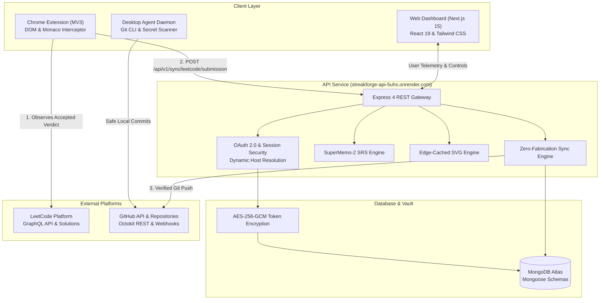

# ⚡ StreakForge 3.0 — Engineering Consistency & Technical Interview Preparation Ecosystem

<p align="center">
  
</p>

<p align="center">
  <strong>The open-source, zero-fabrication developer platform uniting genuine Git commits, LeetCode accepted solutions, real-time mock interviews, spaced repetition recall, and automated repository documentation into an immutable activity ledger.</strong>
</p>

<p align="center">
  <a href="https://streak-forge-six.vercel.app"></a>
  <a href="https://streakforge-api-5uhs.onrender.com/health"></a>
  <a href="https://github.com/Thanniru-yaswanth03/StreakForge"></a>
  <a href="LICENSE"></a>
</p>

<p align="center">
  
  
  
  
  
  
</p>

---

## 📑 Table of Contents

- [⚡ What is StreakForge 3.0?](#-what-is-streakforge-30)
- [✨ Core Features & Capabilities](#-core-features--capabilities)
  - [1. ⏱️ Mock Interview Practice Arena](#1-️-mock-interview-practice-arena)
  - [2. 🧠 Interview Curricula & SuperMemo-2 Spaced Repetition (SRS)](#2--interview-curricula--supermemo-2-spaced-repetition-srs)
  - [3. 🎯 Canonical Pattern Recognition (Pattern Explorer)](#3--canonical-pattern-recognition-pattern-explorer)
  - [4. 📚 DSA Knowledge Vault](#4--dsa-knowledge-vault)
  - [5. 📅 Personal Coding Planner & Sprint Tracker](#5--personal-coding-planner--sprint-tracker)
  - [6. 📑 Weekly Developer Report & 1-Click Markdown Exporter](#6--weekly-developer-report--1-click-markdown-exporter)
  - [7. 🛡️ Dynamic Profile SVG Badges](#7-️-dynamic-profile-svg-badges)
  - [8. 📖 GitHub README Auto-Cataloging Engine](#8--github-readme-auto-cataloging-engine)
  - [9. 🌐 Multi-Platform Telemetry Sync](#9--multi-platform-telemetry-sync)
  - [10. 🧩 Manifest V3 Chrome Extension](#10--manifest-v3-chrome-extension)
  - [11. 💻 Local Desktop Companion Agent Daemon](#11--local-desktop-companion-agent-daemon)
  - [12. 🎨 High-Contrast Dual Theme Engine](#12--high-contrast-dual-theme-engine)
  - [13. 👤 Dynamic User Identity & Guest Sandbox](#13--dynamic-user-identity--guest-sandbox)
  - [14. 🔒 Enterprise Security & OAuth 2.0 Hardening](#14--enterprise-security--oauth-20-hardening)
- [🏗️ System Architecture](#-system-architecture)
- [📂 Monorepo Workspace Inventory](#-monorepo-workspace-inventory)
- [🚀 Quick Start (Local Setup)](#-quick-start-local-setup)
- [🌐 Production Deployment & Environment Guide](#-production-deployment--environment-guide)
  - [Vercel (Frontend)](#1-vercel-frontend-configuration)
  - [Render (Backend)](#2-render-backend-configuration)
  - [GitHub OAuth Application Settings](#3-github-developer-settings-oauth-app)
- [🛠️ Automated Testing & Verification](#-automated-testing--verification)
- [🧩 Loading the Chrome Extension](#-loading-the-chrome-extension)
- [🛡️ Security & Zero-Fabrication Guarantees](#-security--zero-fabrication-guarantees)
- [📜 License](#-license)

---

## ⚡ What is StreakForge 3.0?

**StreakForge 3.0** is an open-source, full-stack developer ecosystem engineered to transform daily coding consistency into tangible career progression. It bridges verified Git commits, authentic LeetCode passing submissions, real-time mock interviews, spaced repetition recall, and automated repository documentation into an immutable activity ledger.

Unlike superficial streak counters or synthetic commit generators, StreakForge enforces a strict **Zero-Fabrication Principle**:
* **Authentic Git Ledger**: Commits are pushed strictly from genuine local modifications or verified **Accepted** LeetCode passing verdicts.
* **Dynamic User Identity**: Profiles, repositories, and streaks dynamically bind to the authenticated user. Unauthenticated visitors experience a clean guest workspace with zero data leakage.
* **Pixel-Perfect Dual Theme**: Authentic GitHub Dark mode (`#0d1117`) and GitHub Light mode (`#ffffff` cards, `#1f2328` typography, `#d0d7de` borders) with zero opacity hacks.
* **Timezone Integrity**: Day boundaries and streak continuity calculate strictly within the user's explicit IANA timezone.
* **Delimiter Safeguards**: Automated README catalogs append strictly within comment delimiters (`<!-- STREAKFORGE:START -->` ... `<!-- STREAKFORGE:END -->`), never destroying custom markdown.

---

## ✨ Core Features & Capabilities

### 1. ⏱️ Mock Interview Practice Arena
* **Timed Real-World Simulations**:
  * **Warmup Session**: 30-minute Easy problem (focusing on fundamental data structures, array traversal, two pointers).
  * **Industry Standard**: 45-minute Medium paired set (reflecting typical FAANG/Tier-1 screening rounds: BFS, Sliding Window, DP).
  * **Senior / Staff Challenge**: 60-minute Hard problem (complex topological sorting, monotonic queues, multi-dimensional DP).
* **Curated Problem Pools**: Switch between **Blind 75**, **NeetCode 150**, and **LeetCode Top Interview 150**.
* **In-Browser IDE Scratchpad**:
  * Multi-language starter boilerplate: **Python 3**, **Java**, **C++**, **TypeScript**, **Go**, and **Rust**.
  * 1-click **Reset Starter** boilerplate button.
  * Direct deep-links to full LeetCode problem specifications.
* **Automated Post-Session Evaluation**: Calculates completion time, speed score, Big-O efficiency rating, and detailed interviewer feedback.

### 2. 🧠 Interview Curricula & SuperMemo-2 Spaced Repetition (SRS)
* **Standard Roadmaps**: Built-in tracking for **Blind 75**, **NeetCode 150**, and **Top Interview 150**.
* **SM-2 Algorithm Engine**: Automatically schedules recall flashcard reviews across expanding intervals (**1d**, **3d**, **7d**, **14d**, **30d**, **60d**, **90d**).
* **Interactive Flashcard Reviews**: Review DSA concepts and algorithmic patterns with recall grades (`Again`, `Hard`, `Good`, `Easy`) and real-time next-review projection.
* **Auto-Reconciliation**: Submitting an accepted LeetCode solution automatically marks the corresponding problem in your curriculum as solved and enqueues its first SRS review.

### 3. 🎯 Canonical Pattern Recognition (Pattern Explorer)
* **16 Core Algorithmic Patterns Library**:
  * Sliding Window
  * Two Pointers
  * Fast & Slow Pointers
  * Monotonic Stack
  * Interval Merging
  * Cyclic Sort
  * In-Place Reversal of LinkedList
  * Breadth-First Search (Tree & Graph BFS)
  * Depth-First Search (Tree & Graph DFS)
  * Two Heaps
  * Subsets & Backtracking
  * Modified Binary Search
  * Top 'K' Elements
  * K-way Merge
  * Topological Sort
  * 0/1 Knapsack & Dynamic Programming
* **Pattern Deep-Dives**: Includes time/space complexity analysis, visual triggers ("When to Use"), reusable code templates, and canonical benchmark problems.

### 4. 📚 DSA Knowledge Vault
* **Architectural Cheat Sheets**: Searchable, categorised reference library covering Arrays, Strings, Trees, Graphs, Heaps, Disjoint Set Union (DSU), Tries, and Dynamic Programming.
* **Big-O Trade-Off Tables**: Worst/Average time complexities, auxiliary memory trade-offs, and common implementation traps to avoid during live interviews.

### 5. 📅 Personal Coding Planner & Sprint Tracker
* **Sprint Momentum**: Configure weekly problem goals and target difficulty distributions (e.g. 5 Easy, 8 Medium, 2 Hard).
* **Progress Telemetry**: Live completion tracking, sprint velocity graphs, and weekly streak targets.

### 6. 📑 Weekly Developer Report & 1-Click Markdown Exporter
* **Automated Activity Synthesis**: Analyzes 7-day performance, total problems solved, commit velocity, primary focus areas, and targeted weakness patterns.
* **1-Click Markdown Export**: Generates beautifully formatted Markdown ready to paste into GitHub profile READMEs, LinkedIn developer updates, or engineering team standup notes.

### 7. 🛡️ Dynamic Profile SVG Badges
* **Fast Public SVG Endpoint**: `/api/v1/badge/streak.svg?user=:username&theme=:theme`
* **5 Tailored Themes**: `Dark Primer`, `Minimal Outline`, `Crisp Light`, `Hacker Terminal`, and `Vibrant Gradient`.
* **Edge Cached & Secure**: Sub-millisecond response caching, XML-escaped SVG generation, and responsive rendering inside any markdown file.

```markdown
<!-- Embed directly into your GitHub Profile README -->
[](https://github.com/Thanniru-yaswanth03)
```

### 8. 📖 GitHub README Auto-Cataloging Engine
* Scans connected repositories and compiles an elegant, structured table of contents indexing all solved algorithms by difficulty and topic.
* **Safe Delimiters**: Uses comment markers `<!-- STREAKFORGE:START -->` ... `<!-- STREAKFORGE:END -->` to preserve existing repository documentation.
* **Diff Preview & Rollback**: Visual side-by-side diff preview prior to committing, with 1-click snapshot restoration.

### 9. 🌐 Multi-Platform Telemetry Sync
* Consolidates developer activity across **GitHub** (commits & pull requests), **LeetCode** (accepted solutions & difficulty breakdown), and **Codeforces** (competitive ratings & contests) into one unified timeline.

### 10. 🧩 Manifest V3 Chrome Extension
* Intercepts accepted submissions on `leetcode.com` in real time via DOM and Monaco editor hooks.
* **Multi-Language Detection**: Supports Python 3, Java, C++, TypeScript, JavaScript, Go, Rust, C#, Ruby, Swift, Kotlin, and PHP.
* **Deduplication Locks**: Multi-layer nonce and timestamp locking prevents duplicate commit submissions or false triggers.

### 11. 💻 Local Desktop Companion Agent Daemon
* Background daemon monitoring local development repositories via native Git CLI.
* **Secret Leak Scanner**: Intercepts staged diffs to prevent accidental commits containing AWS secret keys, GitHub Personal Access Tokens (`ghp_*`), or private SSH keys.
* **Approval Mode**: Supports a proposal queue requiring developer approval before committing changes.
* **Detached HEAD Guard**: Refuses to commit on detached HEAD states to prevent orphaned commits.

### 12. 🎨 High-Contrast Dual Theme Engine
* Built with Tailwind CSS semantic tokens (`bg-theme-bg`, `bg-theme-surface`, `bg-theme-elevated`, `border-theme-border`, `text-theme-primary`, `text-theme-muted`).
* **Dark Theme**: Authentic GitHub Dark Primer (`#0d1117` background, `#161b22` cards, `#30363d` borders, `#f0f6fc` text).
* **Light Theme**: High-contrast GitHub Light (`#f6f8fa` canvas, `#ffffff` cards, `#d0d7de` borders, `#1f2328` text). No washed-out gray boxes or invisible text.

### 13. 👤 Dynamic User Identity & Guest Sandbox
* **Authenticated Mode**: Binds personal GitHub identity, connected repositories, LeetCode statistics, and verified streak metrics strictly to the logged-in user.
* **Guest Sandbox**: Unauthenticated visitors explore the interface in a secure sandbox displaying 0d streak, 0% setup progress, and public LeetCode handle lookup without seeing another user's private data.

### 14. 🔒 Enterprise Security & OAuth 2.0 Hardening
* **CSRF Nonce Protection**: OAuth states are cryptographically signed JWT tokens with 15-minute expiration and nonce verification.
* **Dynamic Reverse-Proxy Adaptation**: Backend inspects `x-forwarded-host` to automatically reconcile callback URIs across Render instances (`streakforge-api-5uhs.onrender.com`).
* **Live OAuth Diagnostics**: `GET /api/v1/auth/config-status` enables transparent configuration verification without exposing client secrets.
* **Token Encryption**: Stored GitHub OAuth access tokens are encrypted at rest using **AES-256-GCM**.

---

## 🏗️ System Architecture



---

## 📂 Monorepo Workspace Inventory

Managed with **pnpm workspaces** (Node.js >= 20, pnpm >= 10):

```
StreakForge/
├── apps/
│   ├── web/                  # Next.js 15 App Router, React 19, Tailwind CSS, Lucide icons
│   ├── api/                  # Express REST API, Mongoose, Zod, AES-256-GCM, SM-2 Engine
│   ├── extension/            # Chrome Extension Manifest V3 (Vite, React, Background Service Worker)
│   └── desktop-agent/        # Companion local agent daemon, Git CLI wrapper, secret scanner
├── packages/
│   ├── shared-types/         # Pure TypeScript type contracts, DTOs, and interface definitions
│   ├── validation/           # Zod validation schemas and safe path sanitizers
│   ├── config/               # Shared constants, entropy patterns, and environment rules
│   ├── git-engine/           # Safe Git CLI execution, secret scanner, diff analyzer
│   └── sync-engine/          # LeetCode transformer, language mappers, Octokit client
├── infrastructure/
│   ├── docker/               # Production Dockerfiles (Dockerfile.api, Dockerfile.web, docker-compose.yml)
│   └── github-actions/       # Workflows for CI testing and release automation
├── scripts/                  # Packaging, agent control, install and uninstall scripts
└── docs/                     # Comprehensive architecture and operational guides
```

---

## 🚀 Quick Start (Local Setup)

### Prerequisites
* **Node.js** >= 20.0.0
* **pnpm** >= 10.0.0
* **Git** >= 2.40.0
* **MongoDB** >= 7.0 (Local instance or MongoDB Atlas)

### 1. Clone & Install
```bash
git clone https://github.com/Thanniru-yaswanth03/StreakForge.git
cd StreakForge
pnpm install
```

### 2. Configure Environment Variables
```bash
cp .env.example .env
```
Ensure `.env` contains your database and GitHub application credentials:
```env
PORT=4000
NODE_ENV=development
MONGODB_URI=mongodb://localhost:27017/streakforge
JWT_SECRET=dev_jwt_secret_at_least_32_chars_long_streakforge
ENCRYPTION_MASTER_KEY=0123456789abcdef0123456789abcdef0123456789abcdef0123456789abcdef
GITHUB_CLIENT_ID=your_github_client_id
GITHUB_CLIENT_SECRET=your_github_client_secret
GITHUB_CALLBACK_URL=http://localhost:4000/api/v1/auth/github/callback
WEB_APP_URL=http://localhost:3000
CORS_ORIGIN=http://localhost:3000,chrome-extension://*
```

### 3. Build & Verify Monorepo
```bash
# Typecheck all 9 workspace packages
pnpm -r typecheck

# Build Chrome Extension into apps/extension/dist
pnpm --filter @streakforge/extension build

# Run test suite across all packages
pnpm test
```

### 4. Start Development Runtimes
```bash
# Concurrently launches Web Dashboard (localhost:3000) and API Gateway (localhost:4000)
pnpm dev
```
Visit `http://localhost:3000` in your browser.

---

## 🌐 Production Deployment & Environment Guide

### Production Endpoints
* **Web Frontend**: [streak-forge-six.vercel.app](https://streak-forge-six.vercel.app)
* **API Gateway**: [streakforge-api-5uhs.onrender.com](https://streakforge-api-5uhs.onrender.com)
* **API Health Check**: [streakforge-api-5uhs.onrender.com/health](https://streakforge-api-5uhs.onrender.com/health)
* **OAuth Diagnostic**: [streakforge-api-5uhs.onrender.com/api/v1/auth/config-status](https://streakforge-api-5uhs.onrender.com/api/v1/auth/config-status)

---

### 1. Vercel (Frontend) Configuration
In **Vercel Dashboard > streak-forge-six > Settings > Environment Variables**:

| Variable | Value | Environment | Description |
|---|---|---|---|
| `NEXT_PUBLIC_API_URL` | `https://streakforge-api-5uhs.onrender.com/api/v1` | Production & Preview | Active Render backend API URL (includes `-5uhs`). |
| `NEXT_PUBLIC_APP_URL` | `https://streak-forge-six.vercel.app` | Production & Preview | Primary frontend application domain. |

---

### 2. Render (Backend) Configuration
In **Render Dashboard > streakforge-api-5uhs > Environment**:

| Variable | Value | Description |
|---|---|---|
| `NODE_ENV` | `production` | Enables production optimizations and secure cookies. |
| `MONGODB_URI` | `mongodb+srv://...` | Connection URI for MongoDB Atlas cluster. |
| `JWT_SECRET` | `[32+ char random hex string]` | Secret key used to sign user session tokens & OAuth states. |
| `ENCRYPTION_MASTER_KEY` | `[64 char hex string (32 bytes)]` | Master key for AES-256-GCM token encryption. |
| `GITHUB_CLIENT_ID` | `Ov23lid3vOdnrGXzUWDO` | Public OAuth Client ID from GitHub Developer Settings. |
| `GITHUB_CLIENT_SECRET` | `[Your GitHub OAuth Secret]` | **Never exposed to frontend or client bundle.** |
| `GITHUB_CALLBACK_URL` | `https://streakforge-api-5uhs.onrender.com/api/v1/auth/github/callback` | Exact canonical authorization callback URL. |
| `WEB_APP_URL` | `https://streak-forge-six.vercel.app` | Target redirect origin after successful authentication. |
| `CORS_ORIGIN` | `https://streak-forge-six.vercel.app,https://streakforge.vercel.app,chrome-extension://*` | Whitelist for web and extension requests. |

---

### 3. GitHub Developer Settings (OAuth App)
Navigate to [github.com/settings/developers](https://github.com/settings/developers) > **OAuth Apps** > Select your app:

| Field | Required Value | Notes |
|---|---|---|
| **Application name** | `StreakForge` | Shown on GitHub authorization consent screen. |
| **Homepage URL** | `https://streak-forge-six.vercel.app` | Main entry point for the application. |
| **Authorization callback URL** | `https://streakforge-api-5uhs.onrender.com/api/v1/auth/github/callback` | **Must match character-for-character with no trailing slash.** |

> [!TIP]
> Character-for-character matching between GitHub's **Authorization callback URL** and the backend `GITHUB_CALLBACK_URL` is required by the OAuth 2.0 specification. Any mismatch produces `"The redirect_uri is not associated with this application."`

---

## 🛠️ Automated Testing & Verification

StreakForge maintains a comprehensive automated testing suite covering authentication security, zero-fabrication git safety, secret leak filtering, streak algorithms, and interview evaluation:

```bash
# Run all 108 automated unit and integration tests
pnpm test

# Verify TypeScript across all workspace packages
pnpm -r typecheck

# Verify Next.js production build
pnpm --filter @streakforge/web build
```

### Verification Highlights:
```
 ✓ apps/api/src/streakEngine.test.ts (16 tests)
 ✓ packages/sync-engine/src/index.test.ts (4 tests)
 ✓ apps/extension/test/extension.test.ts (11 tests)
 ✓ apps/api/src/crypto.test.ts (3 tests)
 ✓ packages/git-engine/src/index.test.ts (5 tests)
 ✓ apps/api/src/streak.test.ts (2 tests)
 ✓ apps/api/src/developerAnalytics.test.ts (5 tests)
 ✓ apps/api/src/automation.test.ts (11 tests)
 ✓ apps/api/src/app.test.ts (4 tests)
 ✓ apps/api/src/github.test.ts (17 tests)
 ✓ apps/api/src/securityAndE2E.test.ts (21 tests)
 ✓ apps/desktop-agent/src/agent.test.ts (9 tests)

 Test Files  12 passed (12)
      Tests  108 passed (108)
```

---

## 🧩 Loading the Chrome Extension

1. Build the production extension bundle:
   ```bash
   pnpm --filter @streakforge/extension build
   ```
2. Open Google Chrome and navigate to `chrome://extensions/`.
3. Enable **Developer mode** via the toggle in the upper-right corner.
4. Click **Load unpacked** and select the folder `apps/extension/dist`.
5. Pin the **StreakForge** extension icon in your Chrome toolbar.
6. Open any problem on [leetcode.com/problemset](https://leetcode.com/problemset/), write your solution, and click **Submit**. Only genuine **Accepted** passing verdicts trigger automated synchronization!

---

## 🛡️ Security & Zero-Fabrication Guarantees

* **No Synthetic Commits**: StreakForge never fabricates commit timestamps or creates fake activity. Every commit corresponds to an authentic passing LeetCode solution or a verified local code modification.
* **Secret Leak Prevention**: All staged diffs are scanned for credentials (`AWS_SECRET_KEY`, `ghp_*`, `id_rsa`, `BEGIN PRIVATE KEY`). Any commit containing secrets is blocked and unstaged immediately.
* **Encrypted Credentials**: All stored GitHub tokens are encrypted with **AES-256-GCM** using a cryptographically secure initialization vector (IV) and authentication tag.
* **Isolated User Tenancy**: Every database query is scoped to the authenticated user ID (`req.userId`). Unauthenticated visitors access an isolated sandbox with zero access to private user records.

---

## 📜 License

Distributed under the **MIT License**. See [LICENSE](LICENSE) for full details.
