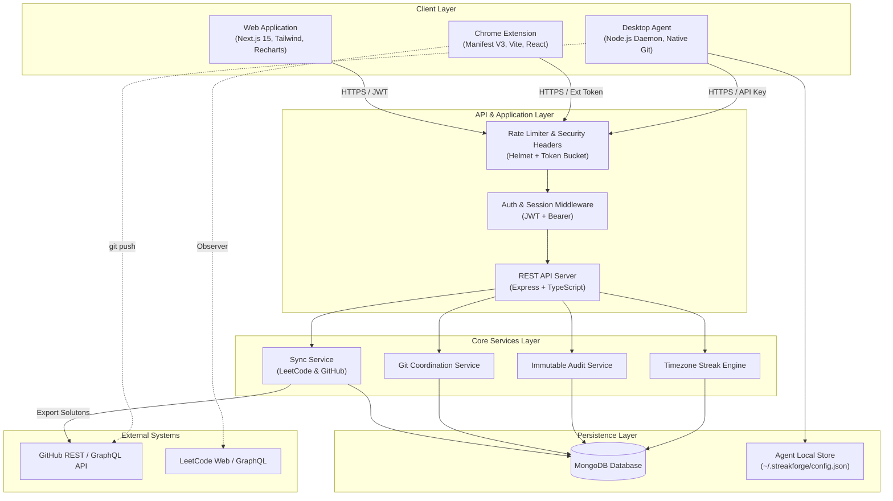

# StreakForge Architecture Specification

## 1. Executive Architecture Summary

StreakForge is a unified developer activity synchronization and consistency platform. It bridges the gap between competitive programming platforms (specifically LeetCode), local developer repositories, and GitHub activity logs.

The architecture is divided into decoupled components connected by strongly typed contracts:

1. **Frontend (`apps/web`)**: Next.js 15+ App Router application providing real-time dashboards, streak visualization, repository management, audit logs, and settings.
2. **Backend API (`apps/api`)**: Node.js/Express REST API in TypeScript backed by MongoDB. Handles authentication, OAuth handshakes, LeetCode submission ingestion, GitHub synchronizations, and audit events.
3. **Chrome Extension (`apps/extension`)**: Manifest V3 extension with an isolated content script running on `leetcode.com`, background service worker for reliable submission queueing, and a React popup UI for status monitoring.
4. **Desktop Agent (`apps/desktop-agent`)**: A local Node.js daemon running on developer machines. Integrates directly with native Git CLI, watches local directories, applies automated commit/push rules based on idle time and schedule, and securely syncs telemetry with the API.
5. **Shared Packages (`packages/*`)**:
   - `@streakforge/shared-types`: Pure TypeScript interfaces, DTOs, and enums.
   - `@streakforge/validation`: Zod schemas validating every incoming/outgoing payload.
   - `@streakforge/config`: Shared configurations, constants, and environment definitions.
   - `@streakforge/git-engine`: Safe Git CLI wrapper, diff parser, commit message builder, and secret-leak preventer.
   - `@streakforge/sync-engine`: GitHub REST integration, LeetCode submission transformer, and conflict resolver.

---

## 2. High-Level System Architecture Diagram

---

## 3. Subsystem Breakdown & Responsibilities

### 3.1 Web Application (`apps/web`)
- **Technology**: Next.js 15+ (App Router), React 19, Tailwind CSS, shadcn/ui components, Recharts for analytics, Lucide icons.
- **Responsibilities**:
  - User onboarding and GitHub OAuth connection.
  - Multi-calendar activity heatmap rendering (GitHub + LeetCode aggregate).
  - Streak status display (current streak, longest streak, remaining hours today).
  - Repository management (connecting/disconnecting target export repositories, selecting default branch and folder structure).
  - Audit log explorer with filtering by component, status, and date range.
  - Desktop agent pairing and live telemetry dashboard.

### 3.2 Backend API (`apps/api`)
- **Technology**: Node.js, Express, TypeScript, Mongoose, Zod.
- **Responsibilities**:
  - GitHub OAuth 2.0 exchange and encrypted token storage.
  - Ingestion of accepted submissions from the browser extension.
  - Scheduled streak calculations and notifications.
  - Desktop agent pairing token generation and heartbeat verification.
  - Dispatching solution export jobs to GitHub via Octokit.
  - Immutable audit logging of all system actions.

### 3.3 Chrome Extension (`apps/extension`)
- **Technology**: Chrome Extension Manifest V3, Vite, React, TypeScript.
- **Architecture**:
  - `content-script.ts`: Runs in an isolated world on `https://leetcode.com/*` and `https://leetcode.cn/*`. Monitors DOM updates and intercepts submission responses via `window.postMessage` bridge or MutationObserver.
  - `background.ts`: Service worker managing offline queue in `chrome.storage.local`, handling retries, and making authenticated calls to `/api/v1/sync/leetcode/submission`.
  - `popup/`: Interactive popup showing authentication state, today's submission count, streak indicator, and recent exports.

### 3.4 Local Desktop Agent (`apps/desktop-agent`)
- **Technology**: Node.js CLI daemon, native Git process execution (`child_process.spawn`), `chokidar` file watcher.
- **Responsibilities**:
  - Monitoring registered local git workspaces.
  - Checking `git status --porcelain` on file change events.
  - Enforcing secret exclusion (blocking `.env`, private keys, secrets).
  - Executing automated commits according to idle time or scheduled intervals.
  - Pushing changes to remote if auto-push is permitted.
  - Emitting activity heartbeats to the central API.

---

## 4. Communication Protocols & Data Formats

1. **Client-to-Server**: REST over HTTPS.
2. **Payload Serialization**: JSON conforming to `@streakforge/validation` schemas.
3. **HTTP Status Conventions**:
   - `200 OK`: Successful read or update.
   - `201 Created`: Successful resource creation.
   - `400 Bad Request`: Validation failure (includes field-level error array).
   - `401 Unauthorized`: Missing, invalid, or expired authentication token.
   - `403 Forbidden`: Insufficient permissions.
   - `404 Not Found`: Resource does not exist.
   - `409 Conflict`: Duplicate submission or concurrent update.
   - `429 Too Many Requests`: Rate limit exceeded.
   - `500 Internal Server Error`: Unhandled backend exception with sanitized error message.

