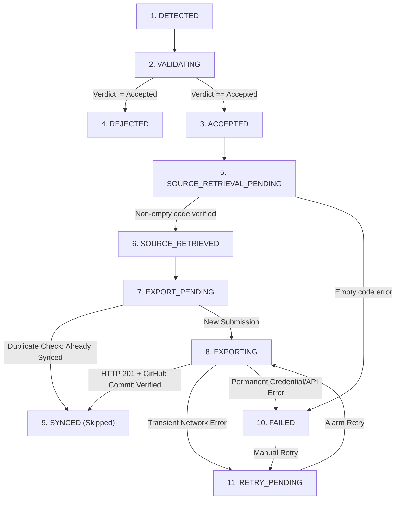

# StreakForge LeetCode Sync — Extension Guide (Manifest V3)

StreakForge LeetCode Sync is an authentic, zero-fabrication Chrome extension built with Manifest V3 that automatically detects genuine accepted LeetCode submissions and synchronizes the actual submitted source code to your GitHub repository.

---

## 1. Installation Instructions

### Unpacked Developer Installation (Chrome, Brave, Edge, Opera)
1. Build the extension:
   ```bash
   pnpm --filter @streakforge/extension build
   ```
2. Open your Chromium-based browser and navigate to:
   - Chrome: `chrome://extensions`
   - Brave: `brave://extensions`
   - Edge: `edge://extensions`
3. Enable **Developer mode** toggle in the top-right corner.
4. Click **Load unpacked**.
5. Select the `apps/extension/dist` folder in the StreakForge repository.
6. The extension icon will appear in your browser toolbar with the badge: **StreakForge LeetCode Sync**.

---

## 2. Extension Architecture (Manifest V3)

```
apps/extension/
├── manifest.json                  # Manifest V3 configuration with scoped permissions
├── options.html                   # Extension Options Page HTML entrypoint
├── index.html                     # Extension Popup HTML entrypoint
├── generate-icons.js              # Script generating real 16x16, 48x48, 128x128 PNG emblems
├── build-manifest.js              # Copies manifest and icons into dist/
├── src/
│   ├── shared/
│   │   ├── types.ts               # Domain types, verdicts, 11-state machine definitions
│   │   ├── stateMachine.ts        # 11-state finite state machine with validation guards
│   │   ├── duplicateRegistry.ts   # Idempotent registry (user:submissionId:repo)
│   │   ├── storage.ts             # Type-safe async chrome.storage.local wrapper
│   │   └── templateResolver.ts    # Folder structure template resolver with sanitization
│   ├── content/
│   │   ├── dom-extractor.ts       # Multi-layout DOM parser (Dynamic & Classic layout)
│   │   └── leetcode-observer.ts   # MutationObserver, active problem reporter & manual capture listener
│   ├── background/
│   │   ├── sync-manager.ts        # Backend sync dispatcher, retry queue, and audit logger
│   │   └── service-worker.ts      # Manifest V3 service worker, alarm scheduler, badge manager
│   ├── popup/
│   │   ├── App.tsx                # Compact developer popup interface
│   │   └── main.tsx
│   └── options/
│       ├── Options.tsx            # Full options management interface with live preview
│       └── main.tsx
└── test/
    └── extension.test.ts          # Vitest suite covering state machine, duplicate registry & templates
```

---

## 3. Submission State Machine (11 Distinct States)

StreakForge processes every detected coding event through an explicit finite state machine with strict transition guards:



### State Definitions
1. `DETECTED`: DOM observer identifies submission result container.
2. `VALIDATING`: Validates verdict, user identity, and metadata.
3. `ACCEPTED`: Confirmed authentic accepted submission.
4. `REJECTED`: Non-accepted verdict (`Wrong Answer`, `Time Limit Exceeded`, `Runtime Error`). Optionally archived locally; never pushed to GitHub.
5. `SOURCE_RETRIEVAL_PENDING`: Initiates source-code extraction from Monaco Editor.
6. `SOURCE_RETRIEVED`: Guard verifies source code is non-empty and language is recognized.
7. `EXPORT_PENDING`: Checks duplicate prevention registry and applies folder structure template.
8. `EXPORTING`: Transmits authenticated payload to StreakForge backend.
9. `SYNCED`: Terminal success state; GitHub commit SHA verified and logged.
10. `FAILED`: Permanent failure recorded with diagnostic message.
11. `RETRY_PENDING`: Queued in local storage for automatic retry via `chrome.alarms` every 5 minutes.

---

## 4. Duplicate Prevention & Idempotency

To prevent duplicate commits, files, or notifications when pages are reloaded:
- **Unique Submission Key**:
  $$\text{Key} = \text{userId} : \text{submissionId} : \text{targetRepoFullName}$$
- When a submission enters `EXPORT_PENDING`, the extension inspects `DuplicateRegistry`.
- If the key already exists:
  - Redundant Git commit is safely bypassed.
  - State transitions directly to `SYNCED`.
  - Previous commit SHA and file path are linked.

---

## 5. Folder Structure Customization

Users can customize destination repository folder paths from the **Options Page**.

### Template Variables:
- `{Language}` / `{language}`: e.g. `Python`, `Java`, `TypeScript`, `Go`, `Rust`
- `{Topic}` / `{topic}`: e.g. `Arrays`, `Dynamic-Programming`, `Strings`, `Trees`
- `{Difficulty}` / `{difficulty}`: `Easy`, `Medium`, `Hard`
- `{id}`: 3-digit padded problem ID, e.g. `001`
- `{slug}`: problem slug, e.g. `two-sum`
- `{ext}`: source code extension with leading dot, e.g. `.py`, `.java`, `.ts`

### Example Templates & Live Outputs:
| Pattern Template | Example Output Path |
| :--- | :--- |
| `leetcode-solutions/{Language}/{Topic}/{id}_{slug}{ext}` | `leetcode-solutions/Python/Arrays/001_two_sum.py` |
| `solutions/{Difficulty}/{id}-{slug}` | `solutions/Easy/001-two-sum/two-sum.py` |
| `{Language}/{slug}{ext}` | `Python/two-sum.py` |

---

## 6. Privacy & Security Rules

- **Zero Content Script Credentials**: GitHub OAuth tokens and private keys are never stored in or exposed to content scripts.
- **Minimum Permissions**: Only requests `storage`, `alarms`, `activeTab`, and `notifications`. No broad `<all_urls>` permission.
- **Targeted Hosts**: Restricted to `https://leetcode.com/*`, `https://leetcode.cn/*`, and the user's StreakForge backend (`http://localhost:4000/*`).
- **Private Archival**: Non-accepted attempts (`Wrong Answer`, `TLE`) are optionally archived strictly in browser local storage and never published.
- **Fail-Safe Source Code Verification**: If Monaco Editor code cannot be extracted, the extension halts export rather than committing empty or boilerplate files.
